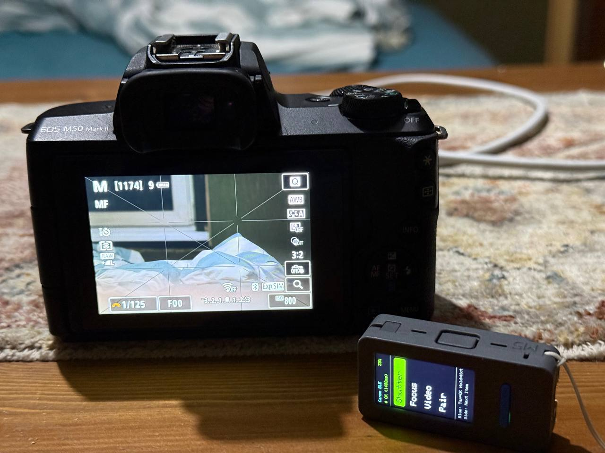

# StickS3-CanonRemote

An autonomous, low-latency Bluetooth Low Energy (BLE) remote control for Canon EOS cameras, built for the **M5Stack M5StickS3** (ESP32-S3).

This project implements the proprietary Canon BR-E1 BLE protocol, features an optimized user interface for the 1.14" vertical LCD (135x240), and fixes long-standing bonding key persistence issues present in modern ESP32 Core 3.x releases.

---

  

## Features

- **Instant Reconnect:** Wake-on-demand command execution without long blocking delays on startup.
- **Full Remote Functionality:**
  - Remote Shutter Release (Instant / 2-second timer mode compatible).
  - Autofocus Trigger.
  - Video Recording Start / Stop toggle with on-screen indicator.
  - Native BLE Pairing mode with camera pairing menus.
- **Hardware-Tailored Interface:**
  - 135x240 IPS LCD UI with battery percentage readout.
  - Front Blue Button (GPIO 11): Tap to send command, Hold to cycle menu.
  - Side Button (GPIO 12): Quick one-tap menu navigation.
  - External Button Support (Optional wired trigger via Grove port).
- **Zero Third-Party BLE Dependencies:** Fully standalone, self-contained single-file sketch compatible with ESP-IDF 5.x / ESP32 Arduino Core 3.x.

---

## Supported Cameras

Compatible with all Bluetooth-enabled Canon EOS cameras, including:
- Canon EOS R, R3, R5, R5 Mark II, R6, R6 Mark II, R7, R8, R10, R50, R100
- Canon EOS M50, M50 Mark II, M6 Mark II, M200
- Canon EOS 6D Mark II, 90D, 250D / Rebel SL3, 850D / Rebel T8i
- Canon PowerShot G7 X Mark III, G5 X Mark II, V10

---

## Key Technical Solutions & Hacks

### 1. NimBLE Bonding Key Persistence Fix
Starting from ESP32 Arduino Core 3.x (ESP-IDF 5), the internal BLE stack on ESP32-S3 devices uses NimBLE. Under default Arduino abstractions, Long Term Keys (LTK) and bonding data are stored only in RAM. Rebooting the remote causes the camera to reject reconnections due to missing cryptographic keys.
- **Fix:** We register a direct low-level store callback hook (`ble_hs_cfg.store_write_cb`) intercepting `BLE_STORE_OBJ_TYPE_OUR_SEC` and `BLE_STORE_OBJ_TYPE_PEER_SEC`. Keys are written directly to ESP32 Flash via `Preferences` and reinjected into the NimBLE store table upon initialization before radio discovery begins.

### 2. Mandatory Re-authentication Handshake
Canon EOS cameras mandate that the remote sends its device identification packet (`0x03` + name) to the pairing characteristic (`00050002-...`) on **every reconnect**, not just during initial pairing. Without this step, cameras ignore shutter release triggers after sleeping or power-cycling.

### 3. Binary BLE Address Preservation
In ESP32 Core 3.x, constructing `BLEAddress` objects from raw strings may discard the address type flag (`Public` vs. `Random`). The sketch stores the raw binary `BLEAddress` object directly in flash to ensure byte-perfect reconnections.

### 4. Acoustic & Power Optimization
On M5StickS3, the AW8737 speaker amplifier causes high idle current draw and audible speaker pop if uninitialized. The firmware explicitly terminates the audio driver via `M5.Speaker.end()` in `setup()` to maximize battery life.

---

## Getting Started

### 1. Requirements
- **Arduino IDE** (v2.2.0 or newer recommended)
- **M5Stack Board Package** (v3.1.0 or newer) or **ESP32 by Espressif** (v3.0.0+)
- **M5Unified Library**: Install via Arduino IDE Library Manager (`Tools -> Manage Libraries... -> M5Unified`).

### 2. Arduino IDE Board Settings
Connect your M5StickS3 via USB-C and configure the following parameters under `Tools`:

| Setting | Value |
| :--- | :--- |
| **Board** | `M5StickS3` (or `ESP32S3 Dev Module`) |
| **USB CDC On Boot** | `Enabled` |
| **Flash Size** | `8MB (64Mb)` |
| **Partition Scheme** | `8M with spiffs (3MB APP/1.5MB SPIFFS)` |
| **PSRAM** | `OPI PSRAM` |
| **Upload Speed** | `921600` |
| **Erase All Flash Before Sketch Upload** | `Disabled` (Enable only for the very first clean wipe) |

### 3. Flashing
1. Open `StickS3_CanonRemote.ino`.
2. Select your device COM port.
3. Click **Upload**.

---

## Pairing with Your Camera

1. On the camera, navigate to:  
   `Menu -> Wireless Settings -> Bluetooth Function -> Connect to Remote`.
2. Select **Pairing**.
3. On the M5StickS3, select the **Pair** menu item and press the Front Blue button.
4. The remote will scan for 15 seconds. Once paired, the screen displays `Paired!` and moves the cursor to `Shutter`.
5. On the camera, set the Drive Mode to **Self-timer: 10 sec / Remote** or **Self-timer: 2 sec / Remote**.
6. Press the Front Blue button to capture photos or start video recording.

---

## License

This project is licensed under the MIT License.
